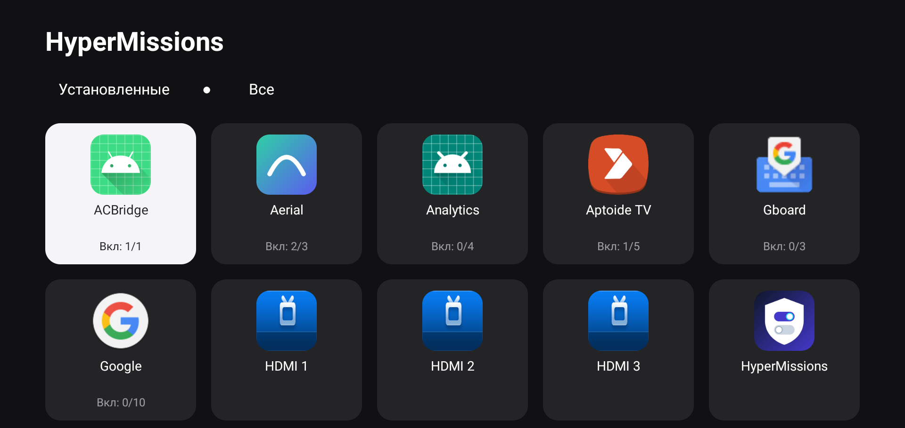
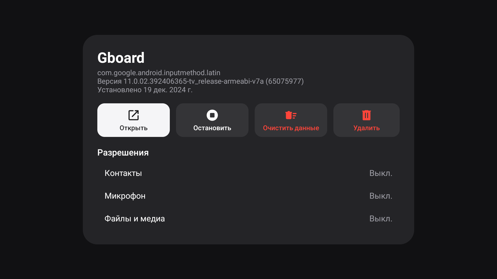
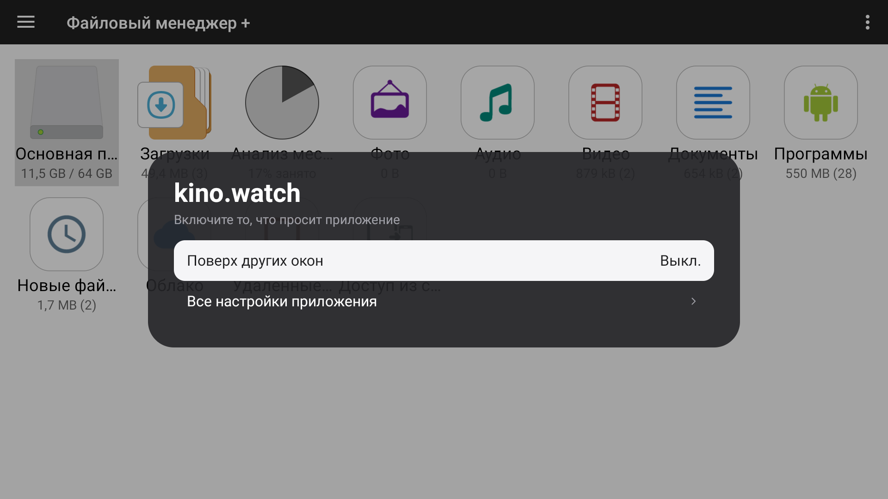

<div align="center">


# HyperMissions

**App permissions for HyperOS TVs, whose firmware has no screen for them.**

See and change what every app is allowed to do, stop it, clear its data, open it or uninstall it,
from the remote. No root, launcher-independent.

[](LICENSE)
[](https://github.com/goodwind/HyperMissions/releases/latest)


**English** · [Русский](README.ru.md)

</div>



## Why

Some TV firmware ships without Android's own App Info and permission screens. Xiaomi HyperOS on the
MiTV-MFTR0 (Android 11), for example, has no "App info", no "All files access", no "Display over
other apps". The result is that:

- there is no way to turn a permission off, or on;
- apps that send you to those screens show "Error" (File Manager+ does, when it wants access to
  storage) and then cannot be set up at all.

HyperMissions is that missing screen, as a normal app.

## What it does

**The apps as cards:** icon, name, and how many of its permissions are on (`On: 3/4`). *Installed*
shows what you put on the TV, *All* every package.

**One app:** version and install date; **Open**, **Force stop**, **Clear data** (press twice) and
**Uninstall**; its permissions by kind (camera, microphone, contacts, location, files and media,
phone, SMS...) and the special accesses it asks for. OK on a row turns it on or off.

<p align="center"></p>

**Answers the apps that ask for those screens.** When an app sends you to App Info, All files access,
Display over other apps, Change system settings or Install unknown apps, a panel opens over it with
just what is off, and Back returns to the app.

<p align="center"></p>

Special accesses covered: **All files access**, **Display over other apps**, **Change system settings**,
**Install unknown apps**.

Languages: English, Русский, Українська, Қазақша, 简体中文, 繁體中文, Español, Português, Français, Deutsch,
Italiano, 日本語, 한국어, العربية, हिन्दी, Türkçe, Polski, Bahasa Indonesia, Tiếng Việt, Nederlands. The app follows
the TV's language. Translations were prepared without native review, corrections are welcome
(see [CONTRIBUTING](CONTRIBUTING.md)). The screenshots show the Russian interface.

## Install

1. Download `HyperMissions-1.0.0.apk` from the [latest release](https://github.com/goodwind/HyperMissions/releases/latest).
2. Install it on the TV. With a computer on the same network:

   ```bash
   adb connect <tv-ip>:5555
   adb install HyperMissions-1.0.0.apk
   ```

   or copy the file to the TV and open it with a file manager.
3. Open **HyperMissions** from the TV's app list.

Check the download if you like: the APK is signed with a key whose certificate SHA-256 is

```
F3:93:9E:A0:02:8E:B3:82:93:B5:0C:F1:98:56:9C:CC:EB:0C:EE:4E:9A:31:19:2D:48:90:CA:8F:D1:9C:C0:D2
```

(`apksigner verify --print-certs HyperMissions-1.0.0.apk`). Updates only install over a copy signed
with the same key.

### One setting on the TV: ADB debugging over the network

Changing another app's permission is something only the system shell may do (see
[How it works](#how-it-works)), so the TV's ADB debugging has to be on, and reachable at
`127.0.0.1:5555` from the app. On most TVs that is *Developer options → USB debugging / ADB
debugging* on. If the app says "Changing permissions needs ADB debugging", it is off, or the TV does
not listen on port 5555; from a computer, `adb tcpip 5555` switches it on until the TV restarts.

The first time you change something the TV asks **"Allow USB debugging?"** for HyperMissions' own key.
Tick **Always allow** and choose **Allow**.

Looking at permissions (the list and the panels) does not need any of this.

## Using it

- **List:** arrows to move, OK to open an app, Back to leave. *Installed* / *All* at the top.
- **Panel:** OK on a permission or a special access turns it on or off (a whole kind at once:
  turning *Contacts* on grants everything the app asks for in it). OK on **Clear data** twice; it
  cannot be undone. **Uninstall** hands over to Android's own confirmation.
- Changing a permission makes Android restart the app, as with the system's own screen.

## How it works

Granting or revoking another app's permission needs `GRANT_RUNTIME_PERMISSIONS`, which only the
**shell** holds, not an app. HyperMissions therefore speaks the ADB protocol to the TV's own `adbd` on
`127.0.0.1:5555` (an authorized key of its own, kept in the app's private storage) and asks the shell
to do it.

That makes it a capability worth looking at, so it is deliberately **not a general shell**. The only
commands the app can send are:

- `pm grant|revoke <package> <permission>`
- `appops set [--uid] <package> <op> allow|deny`, with `op` from a list of four
- `am force-stop <package>` and `pm clear <package>`

Package and permission names must match a dotted-identifier pattern, the operation is a fixed list,
and there is no way to pass a command string. The code is in
[`AdbShell.kt`](app/src/main/java/io/github/goodwind/hypermissions/AdbShell.kt). See
[SECURITY](SECURITY.md) for what the key allows and how to take it back.

Reading uses the ordinary `PackageManager` and `AppOpsManager`, with no privileges.

## What it cannot do

- **Clear cache.** On Android 11 `pm clear` has no `--cache-only`: it ignores the option and wipes
  **all** the app's data. `pm trim-caches` is not per app. So there is no such button.
- **Remove an app from Recents** after Force stop; there is no command for it on Android 11.
- **Special accesses on Android 9 and older**: they are app ops from Android 10, those rows are not shown.
- Changing needs a TV that lets the app reach its own `adbd`. Looking works everywhere.

## Tested on

- Xiaomi MiTV-MFTR0, HyperOS (Android 11): everything above.

Other TVs and Android versions are untested; reports are welcome.

## Build

JDK 17 and the Android SDK (platform 36):

```bash
./gradlew assembleRelease
```

The APK is in `app/build/outputs/apk/release/`. A release is signed with the key named in
`local/signing.properties` (`storeFile`, `storePassword`, `keyAlias`, `keyPassword`; not in version
control). Without that file the build falls back to your debug key: it installs, but cannot update a
release. See [CONTRIBUTING](CONTRIBUTING.md).

## Related

- [Aerial](https://github.com/pengchujin/aerial-tv), a launcher for Android TV. A pull request adds
  the same App Info panel inside it ([#233](https://github.com/pengchujin/aerial-tv/pull/233)).
  If both are installed, only one answers the system's App Info request, so Android never asks which
  one to use.

## License

[Apache License 2.0](LICENSE). Third-party material is listed in [NOTICE](NOTICE).
